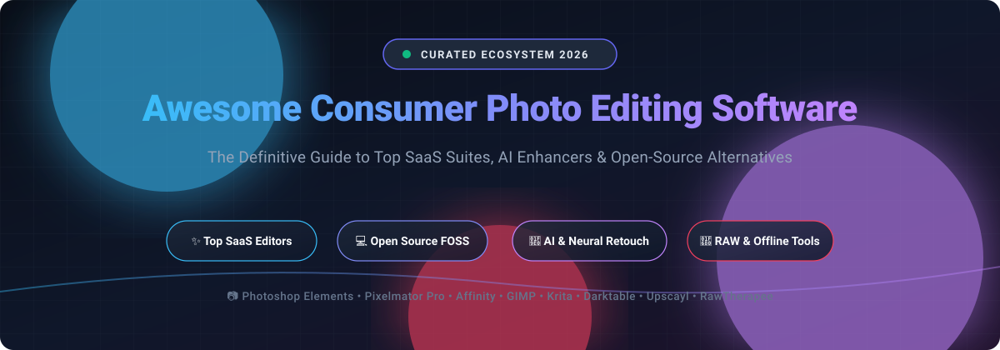
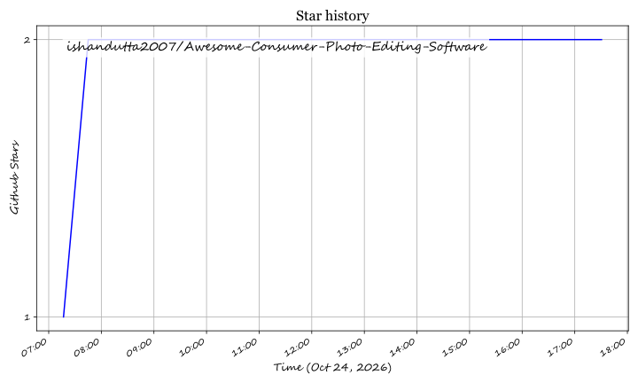

# Awesome Consumer Photo Editing Software 📸🎨

  

  
  
  
  
  
  

---

## 🌟 Top Consumer Photo Editing Software Ecosystem

> **Curated List of SaaS Platforms & Open-Source GitHub Projects for Photo Editing, AI Retouching, and Graphic Design**  
> *Focused on accessible photo enhancement, one-time purchases, self-hosted tools, and avoiding subscription lock-in.*  
> **📅 Last updated: October 2026**

Welcome to the definitive, SEO-optimized directory of **consumer photo editing software**, **RAW processing workflows**, **AI-assisted image upscaling tools**, and **free raster graphics suites**. Whether you are an enthusiast photographer, digital content creator, social media influencer, or casual shutterbug, this curated repository brings together the best commercial software (with explicit pricing and trial terms) and battle-tested open-source alternatives.

### 🔍 Quick Highlights
- 🏆 **Category Leaders**: Adobe Photoshop Elements, Pixelmator Pro, Canva Affinity Photo, Corel PaintShop Pro, and DxO PhotoLab.
- 🆓 **100% Free Professional Suites**: Affinity Photo (freed by Canva in late 2025) and classic FOSS powerhouses like GIMP, Krita, and darktable.
- 🤖 **AI-Native Enhancers**: Next-generation neural upscalers and node-based image transformation pipelines like Upscayl and chaiNNer.
- 📦 **Perpetual & Non-Subscription**: Transparent pricing tiers to help creators budget without surprise monthly recurring charges.

---

## 📑 Table of Contents

- [📊 Sector Overview & Market Dynamics](#-sector-overview--market-dynamics)
- [💻 SaaS & Commercial Platforms](#-saas--commercial-platforms)
- [🔓 Open-Source GitHub Projects](#-open-source-github-projects)
- [🤝 How to Contribute](#-how-to-contribute)
- [💖 Support & Sponsor](#-support--sponsor)
- [⭐ Star History](#-star-history)
- [⚠️ Disclaimer](#️-disclaimer)

---

## 📊 Sector Overview & Market Dynamics

The global photo editing software market is valued at approximately **$1.2B to $12B+** (expanding at a compound annual growth rate of **5%–10%**), stimulated by explosive growth in mobile photography, social media visual marketing, and generative AI features. 

The industry displays a **hybrid market structure**:
1. **Professional Desktop Tier (Highly Concentrated / Oligopolistic)**: Anchored by Adobe (>40%–60% professional market share) along with established studio brands like Corel, CyberLink, and DxO.
2. **Consumer, Web & Mobile Tier (Moderately to Heavily Fragmented)**: Highly dynamic with intense competition among browser-based suites, AI retouching startups, native desktop applications, and thriving open-source communities.

---

## 💻 SaaS & Commercial Platforms

All pricing and free trial terms are verified against current tier offerings. SaaS suites are sorted in **descending order by company scale** (valuation or parent company market capitalization):

| Product | Description | Company Scale (Valuation / Revenue) | Pricing | Free Tier Limit |
| :--- | :--- | :--- | :--- | :--- |
| **[Pixelmator Pro](https://apps.apple.com/app/pixelmator-pro/id1289583905)** | Mac-only professional photo editor with machine learning enhancements, RAW editing, and metal acceleration. | **$5.07 Trillion** Market Cap (Parent: Apple Inc.) | **$49.99** one-time purchase on Mac App Store (or **$12.99/mo** / **$129/yr** via Apple Creator Studio bundle) | **No permanent free tier**; 1-month free trial available via Apple Creator Studio subscription (Mac App Store direct purchase has no free trial) |
| **[Adobe Photoshop Elements 2026](https://www.adobe.com/products/photoshop-elements.html)** | Consumer-friendly photo editor with guided edits, AI enhancements, automated organizing, and a 3-year term license. | **~$102 Billion** Market Cap (Adobe Inc.) | **$99.99** one-time (3-year term non-renewing license) or **$149.99** bundled with Premiere Elements | **No permanent free tier**; 7-day fully functional free trial with full feature access and no credit card required |
| **[Affinity Photo (now free)](https://affinity.serif.com/)** | **Now completely free.** Professional-grade photo editor unified with Designer and Publisher into a single powerhouse application. | **~$35 Billion** Valuation (Parent: Canva) | **Free** ($0.00 forever; Canva unified Affinity Photo, Designer, and Publisher with full capabilities) | **Free forever with no feature limits**: 100% full desktop access across Mac/Windows/iPad with unlimited exports and zero expiration |
| **[Corel PaintShop Pro](https://www.paintshoppro.com/)** | Windows photo editor with adjustment layers, RAW support, HDR tools, and one-time perpetual purchase. | **~$1 Billion+** Valuation / ~$180M+ Rev (Alludo / KKR) | **$79.99** one-time (PaintShop Pro standard tier) or **$99.99** for Ultimate edition | **No permanent free tier**; 30-day fully functional free trial with full feature access and no watermark |
| **[CyberLink PhotoDirector 2026](https://www.cyberlink.com/)** | Consumer photo editor with AI object removal, sky replacement, layers, and subscription or perpetual options. | **~$142 Million** Market Cap (CyberLink Corp., TPE: 5203) | **$39.99/yr** (PhotoDirector 365 starting plan) or **€99.99** ($99.99) one-time perpetual license | **Permanent free tier limited**: Desktop Essential allows max 2 photo exports/day in Expert mode with premium AI tools disabled from export; 30-day promotional trial for full 365 |
| **[Skylum Luminar Neo](https://skylum.com/luminar)** | AI-powered creative photo editor featuring portrait retouching, generative erase, relighting, and sky replacement. | **~$50–$60 Million** Valuation / ~$18M Rev (Skylum) | **$11.95/mo** or **$79/yr** starting tier (or **$199** one-time perpetual license) | **No permanent free tier**; 7-day fully functional free trial with complete access to core tools and extensions |
| **[DxO PhotoLab Essential](https://shop.dxo.com/)** | High-precision RAW photo editor with industry-leading optical lens corrections and DeepPRIME denoising. | **~$50 Million** Valuation / ~$16M Rev (DxO Labs) | **$139** one-time (PhotoLab Essential edition) or **$229** one-time for Elite edition | **No permanent free tier**; 30-day unrestricted free trial with all Elite features fully unlocked and no credit card required |
| **[ON1 Effects 2026](https://www.on1.com/products/effects/)** | Creative effects plugin and standalone image editor loaded with filters, cinematic presets, and AI masking tools. | **~$10–$15 Million** Valuation / ~$3.5M Rev (ON1, Inc.) | **$59.99** one-time purchase (standalone/plugin tier; discounted from $69.99 regular price) | **No permanent free tier**; 30-day fully functional free trial with zero watermark and no credit card required |

---

## 🔓 Open-Source GitHub Projects

Explore the finest free and open-source software (FOSS) alternatives to proprietary photo editing suites. Repositories are **sorted in descending order by GitHub_Stars_Count**:

- **[Upscayl](https://github.com/upscayl/upscayl)**   
  ⚡ **The Free and Open Source AI Image Upscaler.** AGPL-3.0 licensed. Cross-platform desktop tool using deep learning models (Real-ESRGAN, Vulkan-accelerated) to sharpen, upscale, and restore low-resolution photos without cloud servers. Ideal for restoring compressed smartphone photos and historic prints locally.

- **[darktable](https://github.com/darktable-org/darktable)**   
  📷 **The Open-Source Photography Workflow & RAW Developer.** GPL-3.0 licensed. Non-destructive, scene-referred editing pipeline featuring tethered shooting, color calibration, and GPU acceleration. The premier open-source alternative to Adobe Lightroom.

- **[Krita](https://github.com/KDE/krita)**   
  🎨 **The Digital Painting & Creative Image Suite.** GPL-3.0 licensed. Renowned for its world-class brush engine, color management, vector layering, and non-destructive filter layers. Outstanding for creative compositing, retouching, and concept art.

- **[GIMP](https://github.com/GNOME/gimp)**   
  🖌️ **The Full-Featured GNU Image Manipulation Standard.** GPL-3.0 licensed. The quintessential Photoshop alternative. **GIMP 3.0** brings non-destructive editing, modern color management (GEGL), improved PSD handling, and support for modern formats like JPEG XL and WebP.

- **[chaiNNer](https://github.com/chaiNNer-org/chaiNNer)**   
  🔗 **Flowchart / Node-Based Image Processing Architecture.** GPL-3.0 licensed. Intuitive node-graph editor for chaining super-resolution models, face restoration, background removal, color grading, and batch photo adjustments.

- **[RawTherapee](https://github.com/RawTherapee/RawTherapee)**   
  🔬 **Granular RAW Photo Converter & Processing Pipeline.** GPL-3.0 licensed. Provides high-end demosaicing algorithms (AMaZE, RCD), advanced sharpening (RL deconvolution), and CIE Color Appearance Models for unmatched photo fidelity.

- **[Pinta](https://github.com/PintaProject/Pinta)**   
  ✏️ **Lightweight Cross-Platform Drawing and Image Retouching.** MIT licensed. Modeled after Paint.NET, offering a fast, clean interface with layers, unlimited undo history, and over 35 color adjustments and special effects.

- **[Ansel](https://github.com/aurelienpierreeng/ansel)**   
  🎞️ **Streamlined Scene-Referred RAW Photo Editor.** GPL-3.0 licensed. A focused fork of Darktable designed to simplify digital asset management and deliver robust, colorimetrically accurate color grading without bloat.

- **[digiKam](https://github.com/KDE/digikam)**   
  🗂️ **Professional Photo Management & Editing Suite.** GPL-2.0 licensed. Advanced digital asset manager featuring facial recognition, geolocation mapping, auto-tagging, and a comprehensive built-in image editor for batch adjustments.

- **[PhotoFlare](https://github.com/PhotoFlare/photoflare)**   
  ✨ **Simple Yet Powerful Community Image Editor.** GPL-3.0 licensed. Built on C++ and Qt, offering a clean, user-friendly interface inspired by PhotoFiltre with batch photo processing, filters, and color correction tools.

---

## 🤝 How to Contribute

Contributions are warmly encouraged! Help keep this directory current, accurate, and comprehensive:

1. 🍴 **Fork the repository** on GitHub.
2. 🌿 **Create a new branch** (`git checkout -b feature/new-photo-tool`).
3. 📝 **Add or update entries** following existing markdown formatting standards:
   - For SaaS tools: include verified starting prices, parent valuation/revenue, and exact free trial / free tier terms.
   - For open-source tools: include official GitHub repo link and stargazers social badge.
4. 🚀 **Submit a Pull Request** with a descriptive summary of your updates.

---

## 💖 Support & Sponsor

If you find this curated list valuable for discovering photo editing tools or escaping expensive software subscriptions, please consider supporting the project:

- ⭐ **Star this repository** to improve visibility for photographers worldwide.
- 🍴 **Fork and share** with fellow creators, photographers, and developers.
- ☕ **Buy a coffee & sponsor**: Support ongoing research and maintenance via the [GitHub Sponsors Dashboard](https://github.com/sponsors/ishandutta2007).

Thank you for being part of the creative and open-source community! 🙌

---

## ⭐ Star History

---

## ⚠️ Disclaimer

- This is an independent, **community-curated directory** provided for educational and comparison purposes.
- **Affinity Photo Free Shift**: Serif's Affinity suite was acquired by Canva and transitioned to a permanently free unified desktop app in late 2025.
- **Adobe Term Licenses**: Photoshop Elements purchases are issued on 3-year term licenses and expire after 36 months without automatic renewal.
- **Regional Currency Nuances**: All listed prices reflect standard US/EU web pricing as of October 2026; localized regional discounts or tax rates may differ.

---

  <b>Built with ❤️ for photographers, casual editors, and everyone who loves creative freedom without subscription walls.</b>

## ⭐ Star History

<a href="https://star-history.com/#ishandutta2007/Awesome-Consumer-Photo-Editing-Software&Timeline" align="center">
  <picture>
    <source media="(prefers-color-scheme: dark)" srcset="assets/ishandutta2007_Awesome-Consumer-Photo-Editing-Software_growth.svg">
    
  </picture>
</a>
